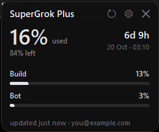
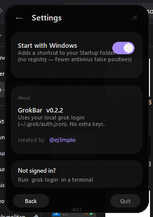
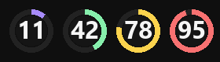

# GrokBar

**Windows system-tray usage monitor for [Grok Build](https://grok.com)** — see how much weekly quota you’ve used without leaving your desktop.

Dark, compact UI inspired by xAI / Grok. Free and open source.

<p align="center">
  
  &nbsp;
  
</p>

<p align="center">
  
</p>

<p align="center">
  <a href="https://github.com/JairoMS27/grokBar/releases/latest"></a>
  <a href="LICENSE"></a>
  <a href="https://x.com/ej3mplo"></a>
</p>

---

## Features

| | |
|---|---|
| **Tray ring** | Color-coded % for Grok Build at a glance |
| **Popup dashboard** | Rounded dark card — ring gauge + **vertical** product bars |
| **Products** | Build · Chat · Imagine · API (when the API reports %) |
| **Weekly window** | Reset countdown + total credit usage |
| **Settings** | Start with Windows via **Startup folder** shortcut (not registry) |
| **Local auth** | Reuses `grok login` — **no extra API key** |
| **Notifications** | Alerts at 70% / 90% / 100% |

---

## Install (users)

### 1. Sign in to Grok (once)

Install / use [Grok Build CLI](https://x.ai) and run:

```powershell
grok login
```

This creates `~/.grok/auth.json`. GrokBar only **reads** that file locally.

### 2. Download the app

Grab **`GrokBar.exe`** from the [latest release](https://github.com/JairoMS27/grokBar/releases/latest).

### 3. Run it

Double-click `GrokBar.exe`. The icon appears in the **system tray** (near the clock).

| Action | Result |
|--------|--------|
| **Left-click** | Open / close dashboard |
| **Right-click** | Menu (refresh, settings, quit) |
| **⚙** in the popup | Settings |

Optional: **Settings → Start with Windows**.

> **SmartScreen / antivirus:** the `.exe` is an **unsigned** open-source build (PyInstaller). Windows may show “Unknown publisher”. Use *More info → Run anyway*, or build from source below. Startup uses a normal Startup-folder shortcut to reduce false positives.

---

## Screenshots

### Dashboard


Weekly Grok Build ring, product breakdown (vertical bars), refresh / web / quit.

### Settings


Start with Windows, about, and creator credit.

### Tray


Healthy (violet) → warning → critical as usage climbs.

---

## Build from source

**Requirements:** Windows 10/11, Python 3.10+

```powershell
git clone https://github.com/JairoMS27/grokBar.git
cd grokBar
python -m pip install -r requirements.txt
python -m grok_bar
```

Package a single `.exe`:

```powershell
.\build.ps1
# → dist\GrokBar.exe
```

Dev helpers:

```powershell
python -m grok_bar --once      # print usage to console
python -m grok_bar --preview   # popup only
```

---

## How it works

1. Loads the session token from `~/.grok/auth.json` (same as the Grok CLI).
2. Calls xAI’s billing endpoints used by `/usage` in the CLI:

   - `GET …/v1/billing?format=credits` → weekly % + per-product usage  
   - `GET …/v1/billing` → optional monthly context (not shown as a big bar in UI)

3. Renders tray icon + popup. Auto-refreshes every ~2 minutes.

**Privacy:** no analytics, no third-party trackers. Network traffic only to xAI for billing data.

See [SECURITY.md](SECURITY.md).

---

## Project layout

```
grokBar/
  grok_bar/          # app package
    api.py           # billing client
    auth.py          # read local grok session
    app.py           # tray + lifecycle
    popup.py         # rounded UI
    settings.py      # prefs + Startup shortcut
    icons.py         # tray glyphs
  assets/            # app icon
  docs/              # screenshots
  build.ps1          # PyInstaller one-file build
  entry.py           # freeze entrypoint
```

---

## FAQ

**Does it need my xAI API key?**  
No. It uses the interactive `grok login` session.

**Token expired?**  
Run `grok login` again, then refresh in GrokBar.

**Antivirus when enabling startup?**  
Older builds wrote to the registry Run key (flagged as “persistence”). Current builds only add a **Startup folder `.lnk`**.

**macOS / Linux?**  
Not yet — Windows tray + Win32 packaging only.

---

## License

[MIT](LICENSE) © [ej3mplo](https://x.com/ej3mplo)

Not affiliated with xAI. Grok and xAI are trademarks of their respective owners.
